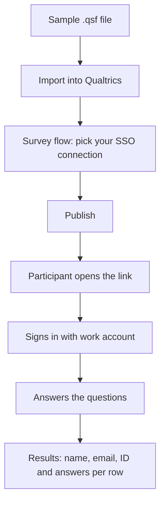
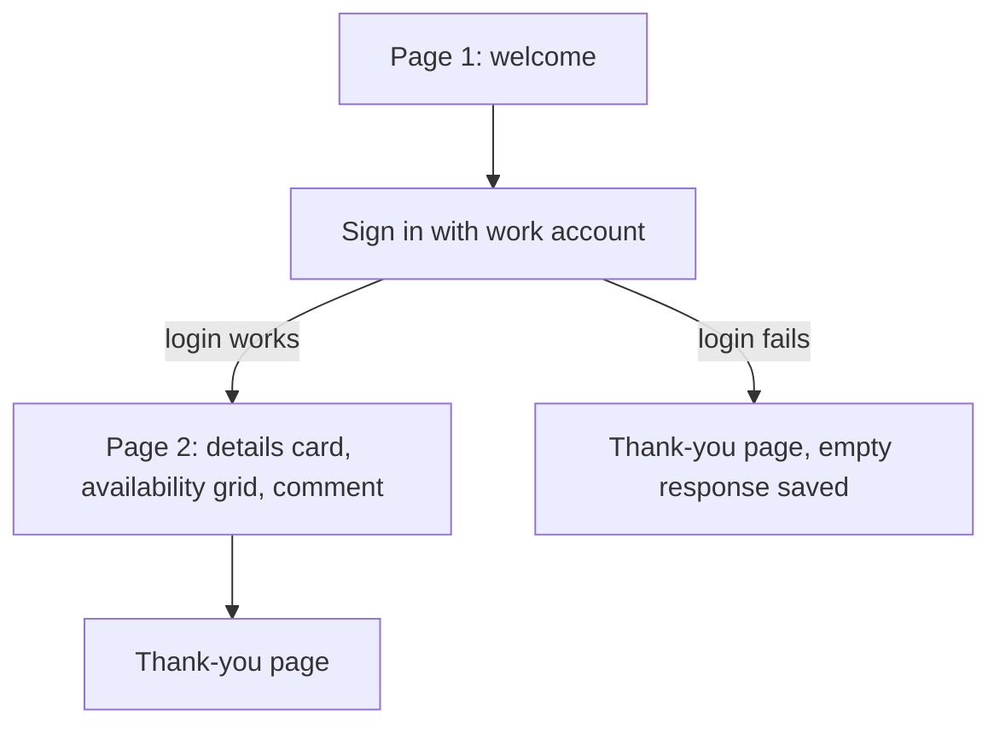
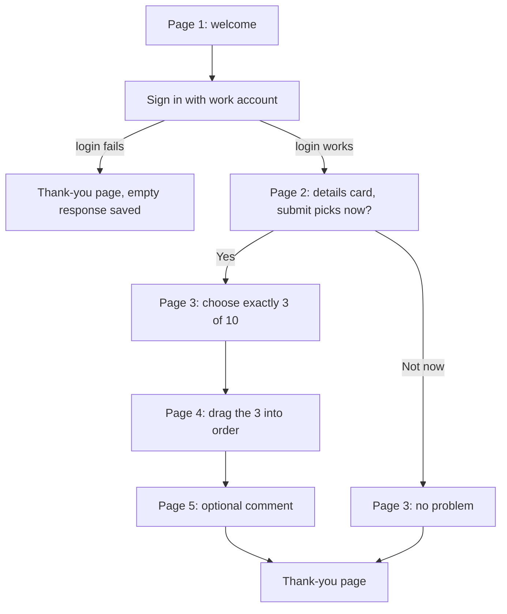
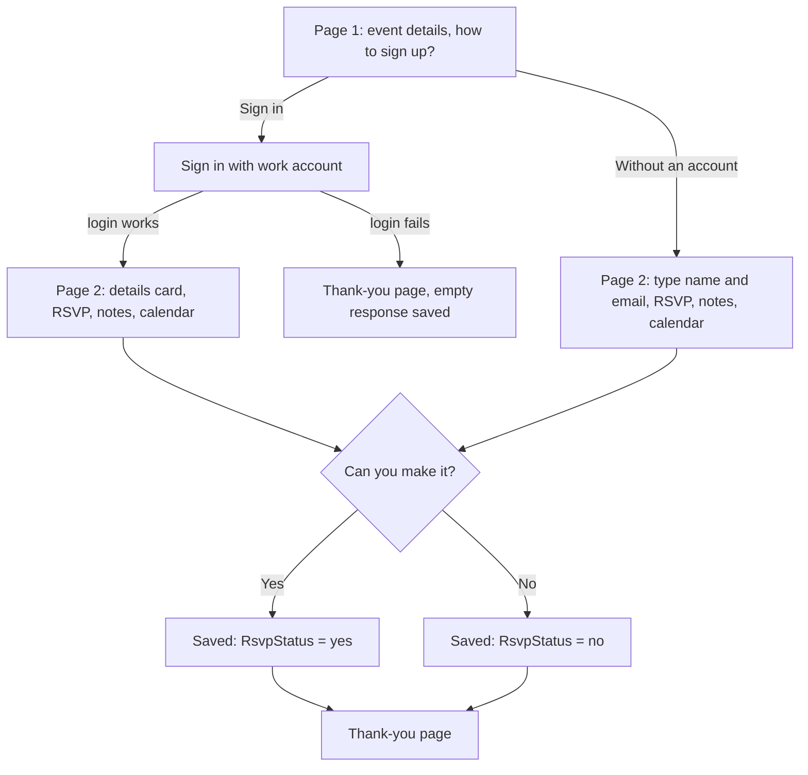
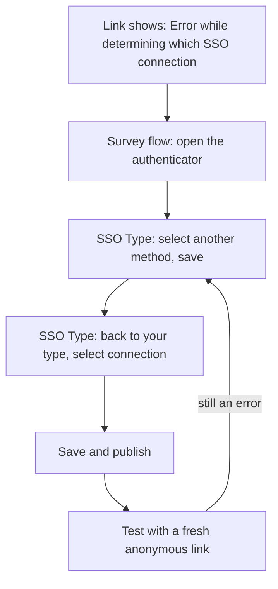
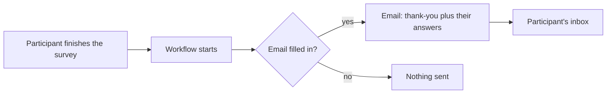

# Ready-made Qualtrics surveys with sign-in: a plain guide

## In short

**What it is.** Three example surveys you can load into Qualtrics, plus
written guidance for the colleague or AI assistant who builds surveys
for you.

**Who it is for.** Anyone who runs surveys in Qualtrics through the web
page and wants to know who answered, without asking participants to type their
name.

**What you get.** Each example asks participants to sign in with their work
account first. Their name, email and ID then land in your results by
themselves. No typing, no typos.

No technical knowledge needed. A few words come back often:

- **QSF file**: one file that holds a whole Qualtrics survey. You load it
  into Qualtrics and get a ready-made survey.
- **SSO** (single sign-on): participants log in with the same work account they
  use for email. Your organisation then tells Qualtrics who they are.
- **Survey flow**: the Qualtrics screen that shows the order of the
  survey's parts and the rules between them
  ([Qualtrics guide](https://www.qualtrics.com/support/survey-platform/survey-module/survey-flow/survey-flow-overview/)).
- **Authenticator**: a step in the survey flow that asks participants to sign
  in before they see what comes after it
  ([Qualtrics guide](https://www.qualtrics.com/support/survey-platform/survey-module/survey-flow/advanced-elements/authenticator/authenticator-overview/)).
- **Embedded data**: extra columns Qualtrics fills in by itself, for
  example the name it got from the sign-in
  ([Qualtrics guide](https://www.qualtrics.com/support/survey-platform/survey-module/survey-flow/standard-elements/embedded-data/)).

The whole journey looks like this:



Stuck, or a colleague can't sign in? Common questions are answered in
the [FAQ](FAQ.md).

## The three example surveys

All three start with a normal Qualtrics page that says what the survey
is about. Only then does the participant sign in. After sign-in they see a
small card: "Is this you? Your answers are linked to" with their name
and email.

### 1. Session availability

For planning: which slots can participants join, and how?

What the participant sees:

1. A welcome page: "Pick your slots". It says they will sign in first,
   and that all times are UTC.
2. The sign-in page of their organisation.
3. One page with the details card, then a grid. Each row is one of 8
   one-hour slots over three days. For each row they choose: no,
   remote, on site, or either. Every row needs an answer. Below
   is an optional comment box.
4. The thank-you page.



What you get in the results: FirstName, LastName, Email and UserID from
the sign-in. Then one answer per slot, coded 1 to 4: 1 no,
2 remote, 3 on site, 4 either. Then the comment.

### 2. Ranked preferences

For choosing: participants pick their top 3 out of 10 options and put them in
order. The sample options are made up, such as "Internal
knowledge base" or "Accessibility audit". You replace them with your own.

What the participant sees:

1. A welcome page. It says they will sign in, pick 3 of 10 projects and
   order them, best first.
2. The sign-in page.
3. The details card and one question: "Submit your picks now?" Yes or
   not now.
4. If **yes**: a page with 10 options in two columns. They must pick
   exactly 3. After the third, the other boxes switch off.
5. A page where they drag their 3 picks into order, first choice on top.
   They must move at least one item, even if they like the order shown.
6. An optional comment page, then the thank-you page.

If **not now**: a short "No problem" page, then the thank-you page.



What you get: FirstName, LastName, Email, UserID. A column
**OptIn** with yes or no. Which 3 options were picked, and the
rank given to each. Then the comment.

### 3. Event attendance

For events: will participants come? This one also lets in participants who have no
work account.

What the participant sees:

1. A page with the event details (a sample lunch talk: date, time, room)
   and one question: "How do you want to sign up?" Sign in with my work
   account, or sign up without an account.
2. Sign-in route: the sign-in page, then a page with the details card.
   Other route: the same page, but with required boxes for first name,
   last name and a valid email instead of the card.
3. On that page, for both: "Can you make it?" (Yes / No), an optional
   notes box, and buttons to add the event to a calendar: Google
   Calendar, Outlook, or a calendar file for other apps.
4. They press "Done" and see the thank-you page.



The two "Saved" steps happen behind the scenes. The participant does not
see them.

What you get: FirstName, LastName and Email for everyone. Typed answers
are copied into the same columns, so all rows look alike. UserID is
filled only for participants who signed in. A column **LoginMethod** says SSO or Manual. A
column **RsvpStatus** says yes or no. The RSVP question itself is coded
1 for yes, 0 for no. Typed email
addresses are less reliable; expect some to bounce.

## Try a sample yourself

1. Download one of the three files from the project's
   `skills/survey-qsf/samples` folder:
   `session-availability-sso.qsf`, `ranked-preferences-sso.qsf` or
   `event-attendance-sso.qsf`. Save it; no need to open it.
2. In Qualtrics, create a new project, choose **Survey**, and pick
   **Import a QSF file**. Select the file you saved
   ([how importing works](https://www.qualtrics.com/support/survey-platform/survey-module/survey-tools/import-and-export-surveys/)).
3. Open **Survey flow**.
4. Click the authenticator step. Choose your organisation's SSO
   connection from the list. The file only holds a placeholder (a row of
   X's), so this step is a must. If no connection is listed, ask your
   Qualtrics brand administrator (the person who manages your
   organisation's Qualtrics account). They switch it on as described in
   [Configuring Organization SSO Settings](https://www.qualtrics.com/support/survey-platform/sp-administration/brand-customization-services/sso/configuring-organization-sso-settings/). The same applies if you later move
   the survey to another Qualtrics account: choose the connection again.
5. Publish the survey.
6. Take the
   [anonymous link](https://www.qualtrics.com/support/survey-platform/distributions-module/web-distribution/anonymous-link/).
   Open it in a normal browser window and go through the survey as a
   participant would. Do not test with preview: sign-in through preview is
   unreliable, as
   [Qualtrics itself warns](https://www.qualtrics.com/support/survey-platform/survey-module/survey-flow/advanced-elements/authenticator/sso-authenticator/).
7. Look at your test response in the results. Your name and email should
   be there.

**If the link shows "Error while determining which SSO connection to use
for this survey".** It may be that the SSO connection is not registered
yet: the editor shows your connection, but the survey did not store it.
The number in brackets after the message is only a report reference. Fix:

1. Open **Survey flow** and click the authenticator step.
2. In the **SSO Type** dropdown, select another method. Save the flow.
   If saving does not stick, publish and then unpublish the survey.
3. Switch **SSO Type** back to your original type and select your
   connection again.
4. Save the flow and publish again. If saving does not stick, publish
   once more.
5. Test again with the anonymous link, in a new normal browser window.



Then change the texts, dates and options to your own.

Note: the files pass every check in the project, but have not been
tried in every Qualtrics account. Small things may differ after import.
For example, the error text shown when a participant picks the wrong number of
options may need to be set again in the editor.

## Why sign in first

- Nobody types their name, so there are no typos and no nicknames.
- You know who answered: each row carries the participant's ID.
- The details card lets participants see that the survey knows who they are.

Two practical warnings:

- **A failed sign-in skips the survey.** If a participant cannot sign in,
  Qualtrics sends them past all the questions to the thank-you page. They
  will say "the survey ended at once". Qualtrics still saves an almost
  empty response
  ([Qualtrics on failed authentication](https://www.qualtrics.com/support/survey-platform/survey-module/survey-flow/advanced-elements/authenticator/authenticator-overview/)).
  Before you count results, remove rows without an email or ID.
- **Tell participants to use a normal browser.** Sign-in can fail when the link
  is opened inside the Teams or Outlook app, or in a private window.
  Strict privacy settings and ad blockers can also get in the way. Ask
  participants to copy the link into a normal browser window.

Also good to know:

- Participants can fill in the survey more than once. Each time is a new row.
  Keep the last row per UserID.
- If the details card shows an empty name, the participant's account did not
  pass it on. The team that runs your organisation's login can fix that.
- The page before the sign-in is on purpose: going straight to sign-in
  is known to fail for some participants.

## Email participants a copy of their answers

Qualtrics can email each participant their own answers as soon as they
finish. You set this up once per survey as a **workflow**: an automatic
"when this happens, do that" rule
([Qualtrics guide](https://www.qualtrics.com/support/survey-platform/actions-module/email-task/)).

The samples already keep each participant's email address in a column
called **Email**. It comes from the sign-in, or from what they typed in
the event sample. The workflow sends to that column.



1. Open the survey and go to the **Workflows** tab. Click **Create a
   workflow**, then **Started when an event is received**.
2. Choose the **Survey response** event, for new responses only (not
   updated or deleted ones).
3. Click **+**, then **Add a condition**: Embedded data **Email** is not
   empty. That skips rows without an address. In the event sample you
   can add a second condition, for example only participants who said
   yes.
4. Click **+**, then **Add a task**, and choose **Email**.
5. Fill in the email:
   - **To**: click the piped text button, choose **Embedded Data Field**
     and type `Email`. It shows up as `${e://Field/Email}`.
   - **From Name**: your name or your team's. Leave the **From Address**
     as it is, unless your organisation has set up its own.
   - **Reply-To**: an address where you actually read replies.
   - **Subject**: for example "Your answers: slot availability".
   - **Message**: a short thank-you. Piped text can add their first name
     (`${e://Field/FirstName}`) or a single answer.
   - Tick **Include Response Report** to add all their answers. In its
     options, set **Expiration** to a short period, such as 7 days: it
     controls how long the link and the PDF keep working. Qualtrics
     warns when you choose Never; don't, because the answers are
     personal. Set the embedded data to **None** or only the survey
     flow's fields, so internal columns stay out of the email.
6. Save the task, check that the workflow is switched on, and publish
   the survey.
7. Test with the anonymous link and your own account, then check your
   inbox and spam folder. Test and preview responses send real emails
   too, so only test with your own address.

Good to know:

- Only finished responses send an email. A participant who stops
  halfway gets nothing.
- Typed addresses in the event sample can be wrong, and those emails
  bounce.
- Nothing arrives? See
  [the FAQ on emails after a response](FAQ.md#emails-after-a-response).

## Further reading

The [FAQ](FAQ.md) answers common questions: sign-in
problems, ranking and validation, emails after a response, themes.

All from the official Qualtrics support site:

- [Survey Flow Overview](https://www.qualtrics.com/support/survey-platform/survey-module/survey-flow/survey-flow-overview/): the screen where you set the SSO connection.
- [Authenticator Overview](https://www.qualtrics.com/support/survey-platform/survey-module/survey-flow/advanced-elements/authenticator/authenticator-overview/): where to place it, retakes, what happens when sign-in fails.
- [SSO Authenticator](https://www.qualtrics.com/support/survey-platform/survey-module/survey-flow/advanced-elements/authenticator/sso-authenticator/): SSO types, the preview warning, error codes.
- [Configuring Organization SSO Settings](https://www.qualtrics.com/support/survey-platform/sp-administration/brand-customization-services/sso/configuring-organization-sso-settings/): for your brand administrator.
- [Embedded Data](https://www.qualtrics.com/support/survey-platform/survey-module/survey-flow/standard-elements/embedded-data/): the extra columns filled by sign-in.
- [Import and Export Surveys](https://www.qualtrics.com/support/survey-platform/survey-module/survey-tools/import-and-export-surveys/): loading a `.qsf` file.
- [Anonymous Link](https://www.qualtrics.com/support/survey-platform/distributions-module/web-distribution/anonymous-link/): the link you send and test with.
- [Email Task](https://www.qualtrics.com/support/survey-platform/actions-module/email-task/): the email step in a workflow, including the response report.
- [Survey Theming](https://www.qualtrics.com/support/survey-platform/survey-module/look-feel/applying-survey-themes/): change the look, logo and colours after import.

## For the technical colleague or AI assistant

You can stop reading here. An AI agent is an AI assistant that can read
and write files; a skill is a set of written instructions it reads before
a specific job. This project holds one skill for `.qsf` files (JSON
text): what real exports contain, what breaks silently on import, how the
SSO authenticator behaves, plus copy-ready pieces for branches, embedded
data, ranking and validation. A validator (a small program that checks a
file's structure) and 40 automated tests come with it. All three samples
pass, with one warning each: the SSO placeholder. Branch coverage is not
checked; that stays a human job. A real export with sign-in contains the
SSO connection's secret key: treat it like a password.

```sh
python3 skills/survey-qsf/scripts/validate_qsf.py skills/survey-qsf/samples/*.qsf --fresh
python3 -m unittest discover -s tests
```

Drop `--fresh` when checking a real export instead of a generated file.
